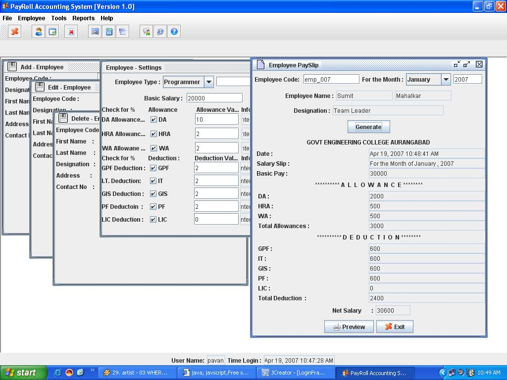

# Payroll System (Java Swing)

> 📦 **Archived student project (2016).** Kept for reference; it is not maintained.

A desktop payroll application for an institution: manages employee records and generates the monthly salary statements, including the Provident Fund (PF) deduction. Java Swing GUI on top of a Microsoft Access database.



## Features
- Admin login
- Add, edit and delete employees
- Monthly salary computation with PF deduction
- Employee report and print window

## Run

```bash
javac *.java
java LoginFrame
```

The Access database (`PayRoll.mdb`) needs a JDBC driver for `.mdb` files, e.g. UCanAccess on current Java versions, because the original JDBC-ODBC bridge was removed in Java 8.

## Tech
Java · Swing · MS Access (JDBC)
